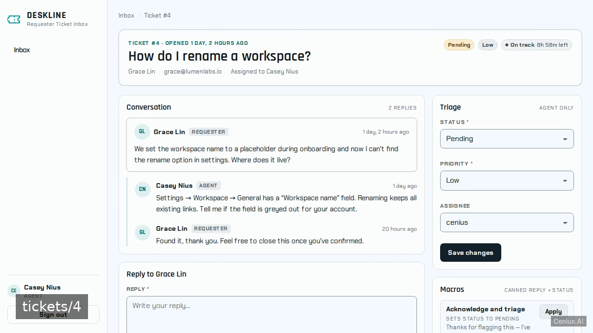
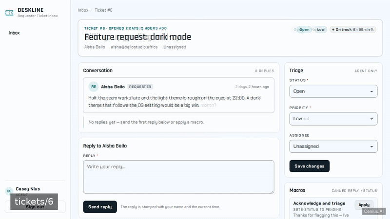
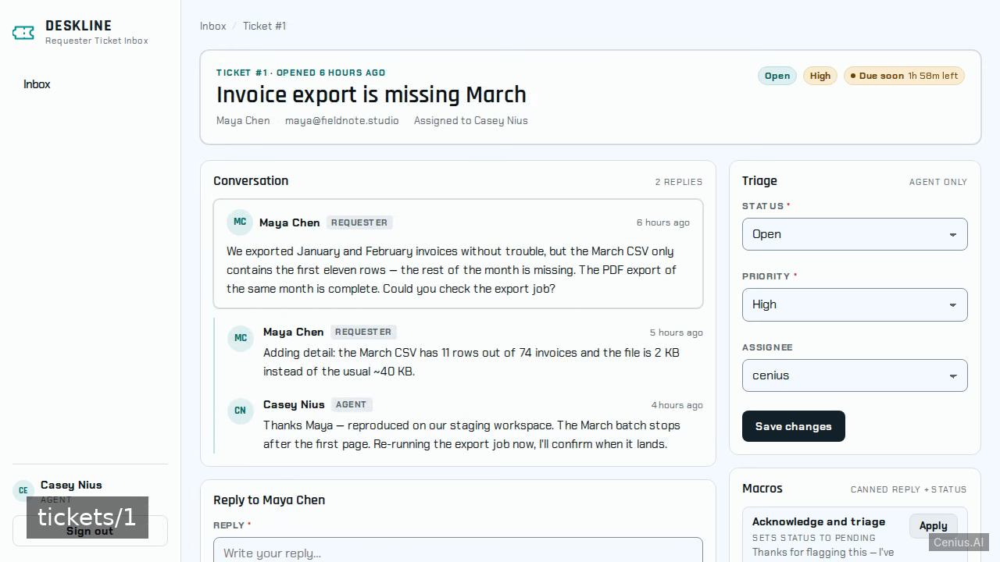
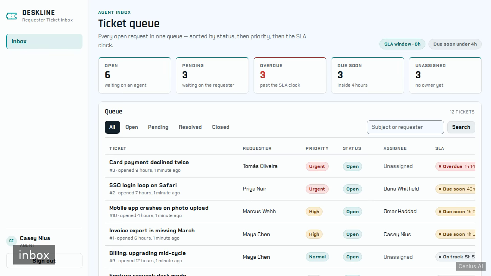

# Deskline Requester Ticket Inbox — production-ready Django CRM system starter

**Deskline Requester Ticket Inbox** is Apache-2.0-licensed and fully open-source: a CRM system written in Django that you can run, modify, and ship commercially without restrictions. Deskline Requester Ticket Inbox is a self-hosted Django helpdesk for small support teams, built as a server-rendered app with Django templates and real persisted data. Grab Deskline Requester Ticket Inbox from this repo and self-host it, or [remix it on cenius.ai](https://cenius.ai/marketplace/p/deskline-requester-ticket-inbox?ref=gh&utm_campaign=deskline-requester-ticket-inbox-django) — the platform grants full rebrand rights on every change.


[](LICENSE)  [](https://cenius.ai)

[](https://cenius.ai/marketplace/p/deskline-requester-ticket-inbox?ref=gh&utm_campaign=deskline-requester-ticket-inbox-django)

> **▶ [Open & edit in cenius.ai](https://cenius.ai/marketplace/p/deskline-requester-ticket-inbox?ref=gh&utm_campaign=deskline-requester-ticket-inbox-django)** — one click to an editable workspace: describe changes in plain English, get an instant preview, one-click deploy and host. Modifications made on the platform come with full rebrand & relicense rights.

_Local clone? See [Quick start](#quick-start) below. cenius.ai is the zero-setup path._

## Demo





▶ **[See it in action](https://cenius.ai/marketplace/p/deskline-requester-ticket-inbox?ref=gh&utm_campaign=deskline-requester-ticket-inbox-django)** — full demo on the project page · [MP4](.github/media/demo.mp4)

## Screenshots

  

## Quick start

```bash
./install.sh   # installs dependencies + seeds demo data
```

See [`INSTALL.md`](INSTALL.md) for full setup and usage instructions.

## Usage guide

### Overview

This is **Deskline Requester Ticket Inbox** — an HTTP API + web UI. This document covers the surface area you can use, with copy-pasteable examples for each entry point. For setup, see `INSTALL.md`.

### Quickstart

After completing the install steps in `INSTALL.md`:

```bash
python manage.py runserver    # start the server
## in another terminal:
curl http://localhost:8000/
```

### Endpoints

Every endpoint below was extracted from the source by the route scanner (Next.js / FastAPI / Flask / Django / Express).

| Method | Path | Source file |
|--------|------|-------------|
| `GET` | `/` | `deskline/urls.py` |
| `GET` | `/accounts/login/` | `tickets/urls.py` |
| `GET` | `/accounts/logout/` | `tickets/urls.py` |
| `GET` | `/accounts/signup/` | `tickets/urls.py` |
| `GET` | `/admin/` | `deskline/urls.py` |
| `GET` | `/health/` | `tickets/urls.py` |
| `GET` | `/inbox` | `tickets/urls.py` |
| `GET` | `/inbox/` | `tickets/urls.py` |
| `GET` | `/login/` | `tickets/urls.py` |
| `GET` | `/portal` | `tickets/urls.py` |
| `GET` | `/portal/` | `tickets/urls.py` |
| `GET` | `/portal/tickets/new` | `tickets/urls.py` |
| `GET` | `/portal/tickets/new/` | `tickets/urls.py` |
| `GET` | `/tickets/:pk` | `tickets/urls.py` |
| `GET` | `/tickets/:pk/` | `tickets/urls.py` |
| `GET` | `/tickets/:pk/delete` | `tickets/urls.py` |
| `GET` | `/tickets/:pk/delete/` | `tickets/urls.py` |
| `GET` | `/tickets/:pk/macro` | `tickets/urls.py` |
| `GET` | `/tickets/:pk/reply` | `tickets/urls.py` |
| `GET` | `/tickets/:pk/update` | `tickets/urls.py` |

#### curl examples

##### `GET /`

_Full guide: [`USAGE.md`](USAGE.md)_

## Features

- Email and password accounts with roles
- Agent ticket inbox
- Agent ticket detail and updates
- Canned macros
- Requester portal
- SLA countdown badges

## Architecture

The repository contains 82 files of Django source, organised under `deskline/`, `static/`, `templates/`, `tickets/`. The setup script (`install.sh`) installs runtime dependencies and loads a starter dataset so the app is immediately usable. For environment-specific setup, see [`INSTALL.md`](INSTALL.md).

## FAQ

### Can I deploy Deskline Requester Ticket Inbox on my own infrastructure?

Clone this repository and run `./install.sh`, then start the app as described in [`INSTALL.md`](INSTALL.md). Deskline Requester Ticket Inbox is fully self-hostable — no external services are required to try it.

### What technologies are in Deskline Requester Ticket Inbox's stack?

Deskline Requester Ticket Inbox runs on Django. This repo holds the full production source: you can inspect every part of it before deploying. Highlights include sLA countdown badges.

### Does the Deskline Requester Ticket Inbox license allow commercial use?

It is. Apache-2.0 licensing means you can build a product on it, sell it, or use it inside a company with no fees. Details: [LICENSE](LICENSE).

### Can I rebrand or white-label Deskline Requester Ticket Inbox?

White-labeling is supported: fork the MIT-licensed source and rebrand it yourself, or use [cenius.ai](https://cenius.ai/marketplace/p/deskline-requester-ticket-inbox?ref=gh&utm_campaign=deskline-requester-ticket-inbox-django) to make changes in a guided workspace — platform modifications come with full rebrand rights.

### Can non-developers customise Deskline Requester Ticket Inbox?

Yes — [load it on cenius.ai](https://cenius.ai/marketplace/p/deskline-requester-ticket-inbox?ref=gh&utm_campaign=deskline-requester-ticket-inbox-django), describe the change in plain English, and you get back a fresh build with your modification applied.

## License & rebranding

Released under the [Apache License 2.0](LICENSE) (© 2026 Cenius AI) — free for personal and commercial use. The Cenius name/logo are trademarks (see NOTICE).

**Need a customized version?** [Remix this app on cenius.ai](https://cenius.ai/marketplace/p/deskline-requester-ticket-inbox?ref=gh&utm_campaign=deskline-requester-ticket-inbox-django) — modifications made on the platform come with **full rebrand & relicense rights** over your derivative.

## Built with cenius.ai

This entire application — code, design, seeded demo data — was generated on **[cenius.ai](https://cenius.ai)** from a plain-English description.

- 🚀 [Build your own app on cenius.ai](https://cenius.ai)
- 🎛️ [Remix Deskline Requester Ticket Inbox on the marketplace](https://cenius.ai/marketplace/p/deskline-requester-ticket-inbox?ref=gh&utm_campaign=deskline-requester-ticket-inbox-django) — open it in a workspace, prompt for changes, and ship your own version.

More open-source apps: [the Cenius-ai catalog](https://github.com/Cenius-ai) · [showcase index](https://github.com/Cenius-ai/showcase)
